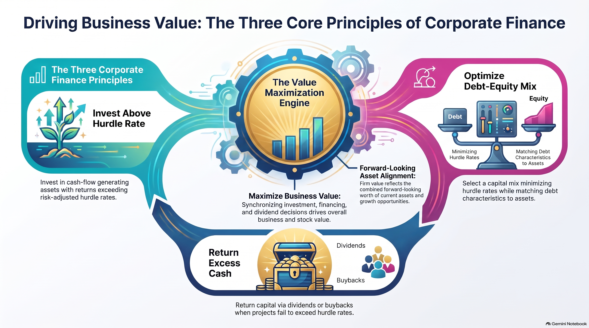

What if almost every single decision made within a business (from launching a global ad campaign to installing a new office water cooler) is secretly a corporate finance decision in disguise?

Corporate finance is far more than Wall Street deal-making or banking transactions; it is the universal logic underlying how businesses create, sustain, and maximize value. In this lesson, we will strip away obscure jargon and accounting abstractions to focus on intuitive, common-sense principles.

- **Distinguish** between a backward-looking accounting balance sheet and a forward-looking financial balance sheet.
- **Evaluate** corporate actions using the three foundational principles of corporate finance: Investment, Financing, and Dividend.
- **Analyze** how a firm's position in the Corporate Life Cycle dictates its strategic and financial choices.
- **Recognize** the real-world dangers of violating corporate finance first principles through concrete historical case studies.

## Deconstructing the Balance Sheet: Accounting vs. Financial Mindset

To understand corporate finance, you must first break free from the **accounting mindset**. Traditional financial statements are designed to look backward, recording historical costs rather than current real-world value. Nowhere is this disconnect more visible than on the classic accounting balance sheet.

An accounting balance sheet records four primary asset categories, each with serious valuation limitations:

- **Long-lived Physical Assets:** Recorded at original purchase price minus accumulated depreciation. A building bought in New York City in 1965 remains on the balance sheet at its historical cost, completely divorced from today's market reality.
- **Short-lived Current Assets:** Inventories and receivables recorded at cost. While closer to market value than older physical assets, they still reflect historical outlay.
- **Investments in Other Companies:** Cross-holdings held for strategic reasons are recorded at original cost. For example, when Yahoo held a 21% stake in Alibaba (originally bought for $1 billion), accounting rules kept that line item recorded at less than half a billion dollars, even as Alibaba's real market value surpassed $200 billion.
- **Intangible Assets and Goodwill:** Accounting struggles with intangible value. Modern mega-cap companies derive their primary value from invisible assets: brand equity, proprietary software, styling, and algorithms. Yet, accounting ignores most internally generated intangibles. Instead, balance sheets get filled with **Goodwill**, a plug variable created during corporate acquisitions. Goodwill exists primarily to make balance sheets balance, offering zero insight into organic business strength.

> **Goodwill** = Purchase Price − Book Value of the assets acquired

### The Financial Balance Sheet

Corporate finance relies on a **financial balance sheet**, which discards historical record-keeping in favor of a forward-looking valuation framework. It divides all assets into two intuitive buckets:

1. **Assets in Place:** Investments the business has already made. For a mature firm like Coca-Cola, this includes established production facilities, existing distribution networks, and core beverage lines.
2. **Growth Assets:** The value attached to investments the company is expected to make in the future. For high-growth tech firms like Nvidia, the vast majority of enterprise value reflects market expectations surrounding future AI chip demand rather than current physical plants.

In a financial balance sheet, **Equity** is never a static historical tally of original capital plus retained earnings. It is a dynamic, forward-looking measure of expected net cash flows that can shift dramatically whenever market expectations change.

## The Big Picture: The Three Core Principles of Corporate Finance

Every single corporate decision boils down to three core principles. If you grasp this framework, the entire discipline of corporate finance unfolds naturally.

### 1. The Investment Principle

Invest in assets that earn a return greater than a minimum acceptable **hurdle rate**.

- **Risk and Capital Mix:** The hurdle rate must be higher for riskier projects and lower for safer ones, reflecting both the riskiness of the underlying asset and the mix of debt and equity used to fund it.
- **Cash Flows, Not Earnings:** Returns must be measured using actual **cash flows** rather than accounting net income. You cannot spend accounting profits; you can only re-invest or distribute real cash.
- **Time Value of Money:** Cash received today is worth more than cash received in the future. Returns must reflect the exact timing of cash flows.
- **No "Garnishing":** Beware of subjective justifications. When project numbers fail to meet the hurdle rate, managers often throw in "strategic considerations" or buzzwords like AI and global expansion to force approval. Corporate finance demands that strategic value be converted into explicit numbers.

### 2. The Financing Principle

Choose a financing mix of **debt** and **equity** that minimizes your hurdle rate and matches your assets.

- **Optimal Capital Structure:** Borrowing money alters your risk profile. The ideal mix of debt and equity is the one that achieves the lowest overall hurdle rate, maximizing total business value.
- **Matching Assets to Debt:** Borrow money in a way that aligns debt cash outflows with asset cash inflows. If you are funding a long-term toll road in Portugal that generates Euro cash flows over 30 years, your financing should be long-term, fixed-rate Euro debt.

### 3. The Dividend (or Return) Principle

If a business cannot find future investments that earn its hurdle rate, it must **return the excess cash to its owners**.

- **No Growth for Growth's Sake:** Holding onto cash to expand a low-return business destroys value.
- **Tailoring the Return Mechanism:** Cash can be returned via **Dividends** or **Stock Buybacks**. The right choice depends entirely on shareholder preferences. Institutional dividend-seeking investors in a utility like ConEd favor steady dividend income, whereas growth-oriented investors in Alphabet (Google) prefer buybacks to optimize tax outcomes and drive capital gains.

Underlying all three principles is a single objective: **maximizing the value of the business**.

## The Corporate Life Cycle and Universal First Principles

Businesses are not static entities; they progress through a **Corporate Life Cycle** much like human beings. A firm's position in this life cycle dictates which financial principles must dominate its attention:

- **Startups / Babies:** Characterized by high mortality rates, erratic cash flows, and heavy capital dependence. Primary focus: survival and refining the business model (e.g., early-stage AI startups).
- **Teenagers:** Boasting enormous market potential accompanied by high volatility and self-sabotaging executive behavior. Think of Tesla in 2019, a firm bursting with promise but prone to unforced operational errors.
- **Prime / Middle Age:** Generating massive cash flows from established market dominance (e.g., Alphabet, Meta, Nvidia). These firms must resist mid-life crisis behavior, such as overpaying for shiny acquisitions that fail to restore youth.
- **Old Age / Decline:** Shrinking growth opportunities and stagnant product lines (e.g., traditional brick-and-mortar retail like Bed Bath & Beyond prior to liquidation). The financial priority here shifts heavily to capital return and orderly contraction.

Corporate dysfunction occurs when companies **refuse to act their age**, such as mature legacy tech firms spending billions trying to re-emerge as venture-style growth engines.

### Corporate Finance is Universal and Unforgiving

Corporate finance principles apply universally across all organizations: public or private, small startups or global conglomerates, developed or emerging market firms. While formalized into academic literature in 1957 by Franco Modigliani and Merton Miller, shrewd entrepreneurs like Dhirubhai Ambani (founder of Reliance Industries) applied these exact intuitive concepts without formal financial degrees.

When managers ignore these common-sense rules, market reality eventually enforces a penalty.

Consider **Steady Safe**, an Indonesian taxi operator in the 1990s. Seeking to expand its fleet of taxis (which had a 10-year useful life generating Indonesian Rupiah revenue), Steady Safe took advice from investment bankers at Peregrine and issued 10-year **US Dollar debt**. Why? Because the nominal interest rate on US Dollar debt was significantly lower than on Rupiah debt.

When the Asian Financial Crisis struck, the Indonesian government was forced to devalue the Rupiah by 65%. Steady Safe's Rupiah revenues plummeted in US Dollar terms while its dollar debt balance remained unadjusted. Steady Safe plunged into bankruptcy, and took its investment bank down with it. Mismatching debt currency and asset cash flows violated basic corporate finance principles, proving that financial gravity cannot be defied forever.

## Summary

Corporate finance is a unified framework of common-sense principles designed to navigate the entire corporate life cycle and maximize firm value.

### Key Takeaways

- **Corporate Finance is Broad:** It encompasses *every* organizational decision that involves the allocation, raising, or returning of money.
- **Financial vs. Accounting Balance Sheets:** Finance focuses on forward-looking cash generation (Assets in Place and Growth Assets) rather than historical costs and artificial line items like Goodwill.
- **The Three Core Principles:**
  1. *Investment:* Earn returns above a risk-adjusted hurdle rate using real cash flows.
  2. *Financing:* Choose a debt-equity mix that minimizes capital costs and matches asset characteristics.
  3. *Dividend:* Return cash to shareholders when attractive hurdle-exceeding investments are unavailable.
- **Context Matters:** Financial priorities evolve across the Corporate Life Cycle; failing to act a company's age destroys value.
- **First Principles are Absolute:** Violating fundamental rules (such as currency or maturity matching) exposes businesses to catastrophic risk.
